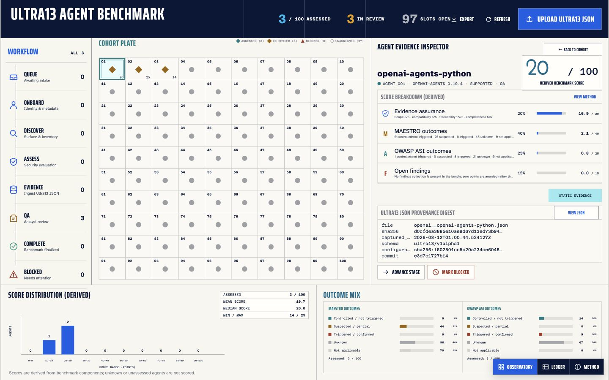

# Ultra13 Agent Assessment Benchmark

A browser-based evidence observatory for operating a 100-agent Ultra13 security assessment, publishing progress, and producing reproducible per-agent scores out of 100.

[Open the live benchmark](https://tommycharade.github.io/ultra13-assessment-benchmark/)



## What this project does

- Holds exactly 100 indexed cohort slots and tracks each agent from intake through QA and completion.
- Imports a cohort from CSV or JSON.
- Accepts one or many Ultra13 JSON evidence bundles through the UI.
- Rejects malformed JSON and bundles that do not resemble Ultra13 output.
- Derives a transparent, versioned `x/100` score using only fields in the uploaded Ultra13 bundle.
- Keeps missing, unknown, unsupported, triggered, and not-applicable outcomes distinct.
- Shows score distribution, mean, median, minimum, maximum, and aggregate MAESTRO/OWASP ASI outcome mixes.
- Preserves a SHA-256 digest and source-path breakdown for every score.
- Exports a report-ready cohort snapshot and score CSV.
- Stores raw uploads in IndexedDB and summary state in local storage; no assessment data is sent to an application server.

The score is a benchmark transformation maintained by this project. It is **not a native Ultra13 score** and makes **no runtime-security claim**.

## Pilot data

The published snapshot was created by uploading three existing Ultra13-generated artifacts through the real UI. No external security, popularity, maintenance, performance, or model-quality data was added.

| Agent | Ultra13 compatibility | Score | Precise total | Unknown outcomes/inputs |
| --- | --- | ---: | ---: | ---: |
| `openai/openai-agents-python` 0.19.4 | Supported | 20/100 | 19.8 | 67 |
| `google/adk-python` 2.6.3 | Supported | 25/100 | 24.6 | 73 |
| `crewaiinc/crewai-examples` 1.6.1 | Unsupported | 14/100 | 14.3 | 27 |

These low pilot values mostly reflect unknown rule outcomes and missing findings arrays. They should not be presented as a claim that one framework is categorically insecure. CrewAI's bundle also reports an unsupported compatibility pairing, while its 70 MAESTRO rules are not applicable and therefore do not earn outcome points.

## 4 September 2026 rerun

The deployed Ultra13 UI successfully discovered and bound the intended deployment units for all three pilot repositories, but the assessment phase did not produce scorable evidence:

| Agent | Selected commit | Discovery candidates | Latest exported job | Current score | Previous completed score |
| --- | --- | ---: | --- | ---: | ---: |
| `openai/openai-agents-python` | `e3d7c1727bf4` | 23 | `scan:failed` | Unscored | 20/100 |
| `google/adk-python` | `44e0b2a8b121` | 44 | `scan:failed` | Unscored | 25/100 |
| `crewaiinc/crewai-examples` | `da94a91e691e` | 35 | `discover:succeeded`; no assessment job exported | Unscored | 14/100 |

The dashboard records these as blocked attempts. Previous scores remain available only as historical baselines and are excluded from current score distribution and aggregate outcome calculations. The Google ADK rerun resolved `HEAD` to a newer commit than the earlier pilot, so it is not a same-revision comparison.

## Benchmark Score v1

| Component | Points | Ultra13-derived calculation |
| --- | ---: | --- |
| Evidence assurance | 20 | Deployment digest alignment (5), exact compatibility (5), rule traceability (5), assessment completeness (5) |
| MAESTRO outcomes | 40 | Severity-weighted outcome credit across applicable rules |
| OWASP ASI outcomes | 25 | Equal-weighted outcome credit across applicable rules |
| Open findings | 15 | Explicit findings array minus open-finding severity penalties |

Outcome credit is conservative:

- Controlled, mitigated, not triggered, or passed: `1.00`
- Suspected, partial, or partial pass: `0.15`
- Unknown, unsupported, triggered, confirmed, failed, or unrecognized: `0.00`
- Not applicable: excluded from the outcome denominator

MAESTRO severity weights are critical `4`, high `3`, medium `2`, low `1`, and `2` when no severity is present. Open finding penalties are critical `6`, high `4`, medium `2`, and low/unspecified `1`. A missing or malformed findings value earns `0/15`; only an explicit empty findings array earns the full 15 points.

The integer benchmark is the rounded sum of the four components. The precise one-decimal total, component points, unknown counts, scoring version, evaluation time, and source paths remain in the exported state.

## Data available for the report

Per agent:

- Repository, framework, exact version, compatibility, stage, blocker, and last update.
- Integer and precise benchmark score.
- Four component scores, unknown counts, explanations, and Ultra13 JSON source paths.
- MAESTRO and OWASP ASI controlled/suspected/triggered/unknown/not-applicable counts.
- Findings and open-findings counts when an explicit findings array exists.
- Ultra13 product/schema identity, build identity, rule-pack versions, configuration digest, commit, capture time, source filename, and source SHA-256.

Across the cohort:

- Assigned, assessed, in-review, completed, and blocked counts.
- Mean, median, minimum, maximum, and ten-point score histogram.
- Aggregate MAESTRO and OWASP ASI outcome counts and percentages.
- Framework, version, compatibility, component, unknown, and evidence-provenance fields for pivoting in the exported CSV/JSON.
- A chronological activity log in the JSON snapshot.

## Run locally

Requires Node.js 20.19 or newer.

```bash
npm ci
npm run dev
```

Then open the local URL printed by Vite.

Quality checks:

```bash
npm run check
npm audit --audit-level=high
```

## Load the 100-agent cohort

1. Open **Ledger**.
2. Select **Import cohort**.
3. Choose a CSV or JSON file containing no more than 100 unique agents.
4. Use the observatory and workflow rail to monitor intake and lifecycle state.
5. After each Ultra13 assessment, select **Upload Ultra13 JSON** and choose one or many bundles.
6. Inspect the derived components, unknowns, compatibility, provenance digest, and raw JSON.
7. Move the agent through QA to Complete, or mark it Blocked with an explicit operational reason.
8. Export the state JSON and score CSV at reporting checkpoints.

CSV columns can include:

```csv
repository,name,framework,version,repositoryUrl,notes
openai/openai-agents-python,OpenAI Agents Python,openai-agents,0.19.4,https://github.com/openai/openai-agents-python,
```

JSON may be an array of the same records or an object with an `agents` array. See [`examples/cohort-example.csv`](examples/cohort-example.csv).

## Publishing progress

The interface deliberately has no write backend. Browser state is private to the current browser until an operator publishes a checkpoint:

1. Use **Export** in the observatory.
2. Replace [`public/data/assessment-state.json`](public/data/assessment-state.json) with the exported snapshot.
3. If remote raw-JSON inspection is required, copy each reviewed Ultra13 bundle into a public evidence directory and set its relative `evidence.rawUrl` in the snapshot.
4. Run `npm run check`, commit, and push to `main`.
5. GitHub Pages rebuilds the live dashboard.

This is the workflow Codex will use to update and check assessment progress. Do not publish raw evidence until it has been reviewed for secrets, personal data, or local filesystem paths.

## Persistence and evidence boundary

- Summary state: browser `localStorage`.
- Raw uploaded bundles: browser `IndexedDB`, keyed by SHA-256.
- Shared read-only state: `public/data/assessment-state.json`.
- Pilot raw evidence: `public/sample-data/*.json`.
- Processing: entirely in the browser.
- Analytics/telemetry: none.

On startup, the newest checkpoint wins between local state and the published snapshot. If neither exists, the application renders an empty 100-slot cohort. It never falls back to invented agents or scores.

## Project structure

```text
src/main.ts             UI, workflow controls, views, imports, exports
src/ultra13.ts          Ultra13 validation and normalization
src/scoring.ts          Benchmark Score v1
src/storage.ts          Local summary/raw evidence persistence
public/data/            Published cohort snapshot
public/sample-data/     Three Ultra13 pilot bundles
PRODUCT.md              Product boundary and operating model
DESIGN.md               Evidence Observatory design system
.github/workflows/      Tests, build, and GitHub Pages deployment
```

## Deployment

Pushes to `main` run the test/build gate and deploy `dist/` to GitHub Pages. The workflow uses GitHub's supported Pages artifact and deployment actions. The site uses relative asset paths, so it works under the repository's project-page URL.
